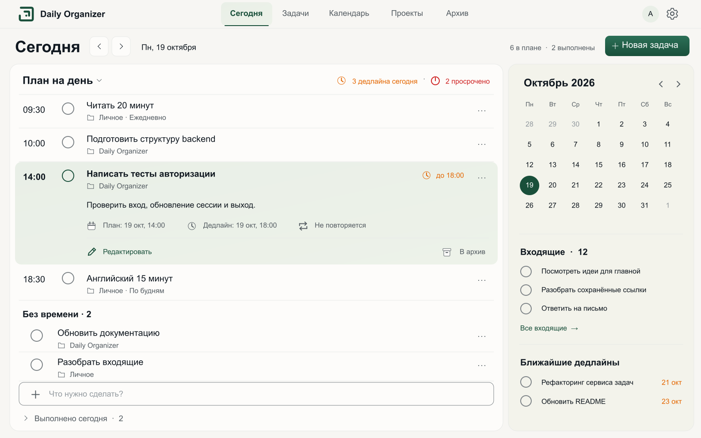
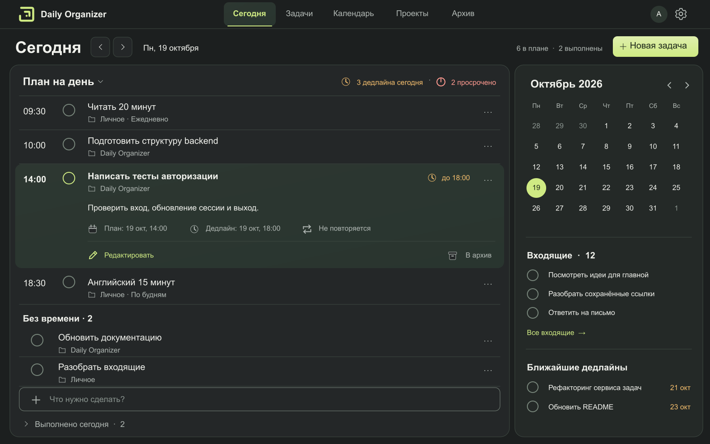
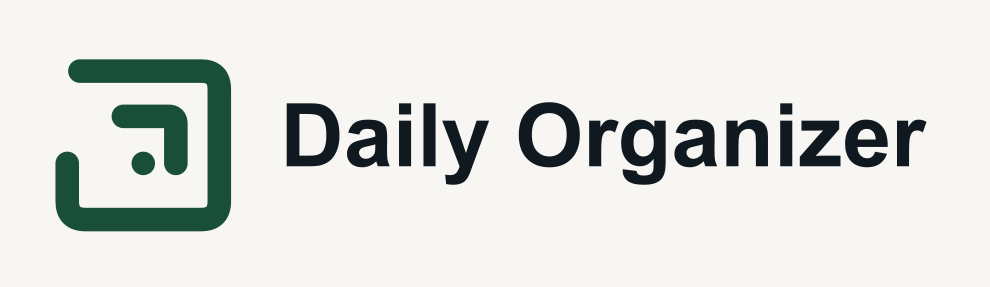

# Daily Organizer · новый UI

**[Открыть альбом всех макетов](mockups.html)** · **[Сверить с утверждённым Today](comparison.html)** · [Аудит приложения](AUDIT.md) · [Спецификация интерфейса](DESIGN.md) · [Токены](tokens.json)

Комплект по [Issue #36](https://github.com/SergeyMotynga/daily_organizer/issues/36): **39 экранов и состояний × 2 темы × desktop/mobile = 156 макетов**. Каждый сохранён как SVG с контурным текстом и PNG, полученный из этого SVG. Текстовые источники макетов сохранены отдельно. Исходники приложения не менялись.

Статус: **для согласования пользователем**. Это статические макеты, не новая работающая версия приложения. Реализация — [#37](https://github.com/SergeyMotynga/daily_organizer/issues/37), последующее тестирование — [#38](https://github.com/SergeyMotynga/daily_organizer/issues/38).

После замечаний пользователя 20 октября восстановлены пропорции Today, ширина контекста, типографика и палитра; пересобран весь альбом. Небольшие отличия рисунка шрифта и иконок от растрового эталона описаны в DESIGN.md.

## Посмотреть

Откройте `mockups.html` из этой папки в обычном браузере. Сервер и приложение для альбома не нужны. У каждой карточки есть ссылки на обе темы, мобильные варианты и PNG. При скачивании сохраните структуру папок.

| Светлая тема | Тёмная тема |
|---|---|
|  |  |

[Обзор основных экранов](contact-sheet.png) · [Обзор мобильных вариантов](mobile-contact-sheet.png)

## Что внутри

| Папка / файл | Назначение |
|---|---|
| `comparison.html` | Светлый/тёмный эталон рядом с восстановленным Today; просмотр в натуральном размере |
| `source/` | Генератор SVG, контуры шрифта, SVG → PNG и валидатор; [инструкция](source/README.md) |
| `verification.json` | Машиночитаемый результат текущей проверки артефактов |
| `renders/` | 156 SVG и 156 PNG; имя экрана, необязательное `-mobile`, затем `-light` или `-dark` |
| `assets/` | 9 SVG логотипа: знак, `currentColor`, светлая/тёмная/чёрная/белая версии, lockup с контурным названием; PNG-превью |
| `evidence/` | 48 скриншотов работающего приложения с отдельным QA-аккаунтом |
| `references/` | Выбранные ранее светлый/тёмный Today и знак «Маршрут» |
| `AUDIT.md` | Маршруты, действия, поля, ограничения, свидетельства и соответствие новым макетам |
| `DESIGN.md` | Палитра, размеры, состояния, адаптивность, поведение и правила логотипа |
| `tokens.json` | Три слоя токенов: исходные значения, семантика, компоненты |
| `manifest.json` | Машиночитаемый реестр экранов и размеров всех вариантов |
| `VERIFICATION.md` | Результаты проверок артефактов и ограничения проверки |

## Основные макеты

В таблице — светлые desktop-исходники. Все соответствующие тёмные и мобильные варианты доступны в альбоме.

| Группа | Экраны |
|---|---|
| Сегодня | [С задачами](renders/today-light.svg), [пусто](renders/today-empty-light.svg) |
| Планирование | [Все задачи](renders/planning-light.svg), [период](renders/planning-filter-light.svg), [нет результатов](renders/planning-empty-light.svg) |
| Календарь | [Неделя](renders/calendar-week-light.svg), [месяц](renders/calendar-month-light.svg) |
| Архив | [С задачами](renders/archive-light.svg), [пусто](renders/archive-empty-light.svg), [удаление](renders/archive-confirm-light.svg) |
| Проекты | [Активные](renders/projects-light.svg), [архивные](renders/projects-archived-light.svg), [пусто](renders/projects-empty-light.svg) |
| Проект | [Доска](renders/project-board-light.svg), [список](renders/project-list-light.svg), [массовые действия](renders/project-bulk-light.svg), [пустая доска](renders/project-empty-light.svg) |
| Управление проектом | [Создание](renders/project-create-light.svg), [настройки](renders/project-settings-light.svg), [удаление](renders/project-settings-confirm-light.svg), [колонки](renders/project-column-edit-light.svg) |
| Задача | [Создание](renders/task-create-light.svg), [редактирование](renders/task-edit-light.svg), [детали](renders/task-details-light.svg), [без проекта](renders/task-no-project-light.svg), [ошибки](renders/task-invalid-light.svg), [удаление](renders/task-delete-light.svg) |
| Повторения | [Форма](renders/task-recurring-light.svg), [все правила](renders/task-recurrence-options-light.svg), [детали](renders/task-occurrence-light.svg) |
| Авторизация | [Вход](renders/login-light.svg), [ошибка](renders/login-error-light.svg), [регистрация](renders/register-light.svg), [валидация](renders/register-error-light.svg), [успех](renders/register-success-light.svg) |
| Общая система | [Состояния](renders/states-light.svg), [меню и фильтры](renders/controls-light.svg), [компоненты](renders/components-light.svg), [логотип](renders/logo-light.svg) |

## Логотип

[Знак — светлый](assets/route-light.svg) · [Знак — тёмный](assets/route-dark.svg) · [С названием — светлый](assets/route-lockup-light.svg) · [С названием — тёмный](assets/route-lockup-dark.svg)

Знак перерисован в векторе, без вложенного PNG. В standalone-версии с названием текст переведён в контуры. Название Daily Organizer пока рабочее; знак от него не зависит.

## Данные и требования

В локальном приложении создан `QA UI36`: 2 проекта и 14 вымышленных задач. Пароль не входит в Git. Тестовые записи оставлены для повторного прохода. Существующие личные данные пользователя не редактировались.

Новые UX-решения пока не объявлены принятыми требованиями. [Приватный черновик Notion](https://app.notion.com/p/3fe678c73f4781df8599e58df97ed940) содержит аудит и направление для согласования; после выбора места его можно перенести в хаб проекта.
